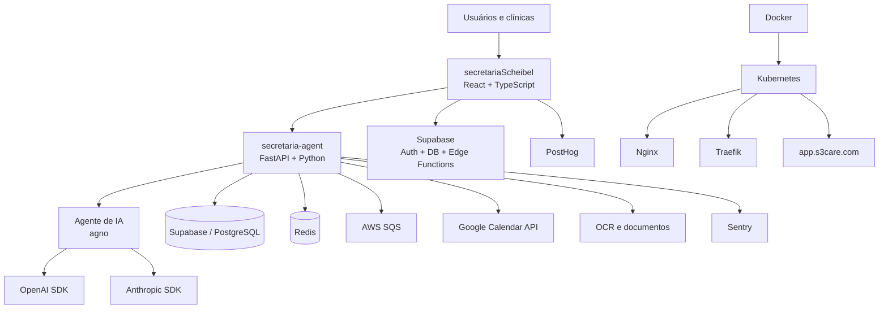
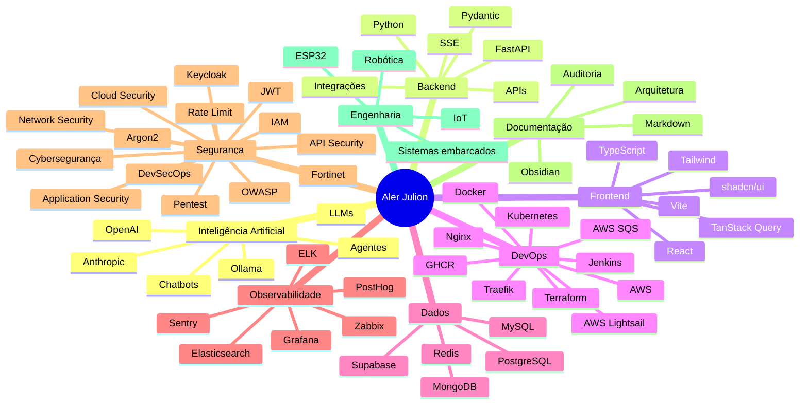
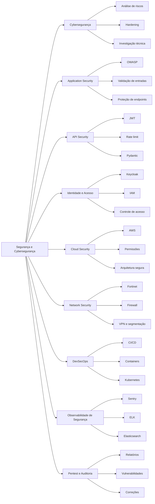
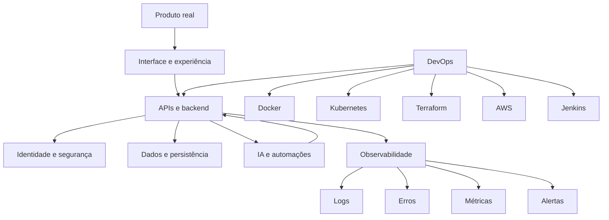

# Olá, eu sou o Aler Julion

### Engenheiro de IA | DevOps | Backend | Cloud | Segurança | Observabilidade

Desenvolvo e opero soluções que conectam **IA**, **backend**, **DevOps**, **cloud**, **segurança**, **observabilidade**, **dados** e **automação**.

Tenho foco em produtos reais, arquitetura escalável, integração entre serviços, operação em Kubernetes e aplicações com agentes de IA.

---

## Sobre mim

Sou profissional de tecnologia com base em **Engenharia de Computação**, atuando com desenvolvimento, DevOps, cloud, segurança, observabilidade, automação e Inteligência Artificial.

Trabalho com aplicações modernas envolvendo **React**, **TypeScript**, **Python**, **FastAPI**, **Supabase**, **Redis**, **Docker**, **Kubernetes**, **AWS**, **Terraform**, **Jenkins**, **Keycloak**, **Sentry**, **ELK** e integrações com modelos de IA como **OpenAI** e **Anthropic**.

Minha trajetória também inclui infraestrutura, redes, Fortinet, monitoramento, robótica e sistemas embarcados. Essa base amplia minha visão técnica para projetar sistemas de ponta a ponta: do produto ao deploy, da segurança à observabilidade.

---

## Stack principal

### Inteligência Artificial e agentes

  
  
  
  
  
  

### Linguagens, frontend e backend

  
  
  
  
  
  

  
  
  
  
  

  
  
  
  
  
  

### Estado, dados no frontend e experiência de produto

  
  
  
  
  
  
  

### DevOps, cloud e infraestrutura como código

  
  
  
  
  
  
  
  
  
  
  

### Bancos, cache e serviços

  
  
  
  
  

### Observabilidade, logs e monitoramento

  
  
  
  
  

### Segurança, cybersegurança, identidade e qualidade

  
  
  
  
  
  
  

  
  
  
  
  
  
  

### Testes, documentos e produtividade

  
  
  
  
  
  

### IoT, robótica e sistemas embarcados

  
  
  
  

---

## Projetos e stacks utilizadas

### secretariaScheibel — Frontend web

Aplicação SPA robusta voltada ao produto HealiX/Narke.

| Categoria | Stack |
|---|---|
| Linguagem e build | TypeScript, Vite 5, Bun, npm |
| UI | React 18, shadcn/ui, Radix UI, Tailwind CSS 3, Framer Motion, Lenis, Lucide, React Icons |
| Estado e dados | TanStack Query, persistência de query, React Hook Form, Zod, React Router 6 |
| Recursos de produto | TipTap, xyflow/react, dnd-kit, Recharts, Embla, PostHog |
| Backend-as-a-Service | Supabase, Supabase Edge Functions com Deno/TypeScript |
| Testes | Vitest, Testing Library, jsdom |
| Deploy | Docker, GHCR, Kubernetes, Nginx, Traefik, AWS Lightsail |

### secretaria-agent — Backend de agente IA/WhatsApp

API Python para agente voltado a clínicas médicas.

| Categoria | Stack |
|---|---|
| Linguagem | Python 3.11+ |
| API | FastAPI, Uvicorn, Pydantic 2, SSE com sse-starlette |
| IA e agentes | agno, Anthropic SDK, OpenAI SDK |
| Dados e serviços | Supabase, Redis, AWS SQS com aioboto3 |
| Segurança | JWT, Argon2, rate limit com slowapi |
| Integrações | Google APIs, Google Calendar |
| Documentos e OCR | pytesseract, Pillow, pdf2image, pdfplumber, python-docx, openpyxl |
| Observabilidade | Sentry |
| Resiliência | tenacity |
| Testes | pytest, pytest-asyncio, fakeredis |
| Deploy | Docker, Kubernetes |

### apresentacoes — Geração automatizada de slides

Scripts para geração de apresentações técnicas.

| Categoria | Stack |
|---|---|
| Runtime | Node.js |
| Módulos | CommonJS |
| Geração de slides | pptxgenjs |
| Imagens | pngjs |
| Saída | Arquivos PPTX |

### documentacao_tecnologia — Base de conhecimento

Vault técnico para documentação, guias, planejamento, templates e estudos.

| Categoria | Stack |
|---|---|
| Documentação | Markdown |
| Organização | Obsidian |
| Versionamento | Git |

### docs — Auditoria, arquitetura e segurança

Repositório de documentação técnica, auditoria arquitetural e materiais de segurança.

| Categoria | Stack |
|---|---|
| Documentação | Markdown |
| Conteúdo | Auditoria arquitetural, relatórios, pentest, análise técnica |
| Segurança | Relatórios e documentação de pentest HealiX |

---

## Resumo por ecossistema

| Ecossistema | Onde aparece |
|---|---|
| TypeScript, React e Node.js | Frontend secretariaScheibel e geração de apresentações |
| Python e FastAPI | Backend secretaria-agent |
| Deno e TypeScript | Supabase Edge Functions |
| Supabase, Redis e IA | Produto HealiX/Narke |
| Docker e Kubernetes | Deploy dos projetos principais |
| AWS | Stage, serviços cloud e mensageria com SQS |
| Sentry, ELK e Elasticsearch | Observabilidade, logs e erros |
| Markdown e Obsidian | Documentação técnica e base de conhecimento |

---

## Arquitetura geral dos projetos principais

---

## Mapa de competências

---

## Segurança e cybersegurança

Tenho experiência e interesse técnico em segurança aplicada em diferentes camadas: aplicação, APIs, identidade, cloud, redes, infraestrutura, observabilidade e operação.

### Camadas de segurança com as quais trabalho

| Camada | Práticas e tecnologias |
|---|---|
| **Cybersegurança** | Análise de riscos, hardening, investigação técnica, documentação de segurança e melhoria contínua |
| **Application Security** | OWASP, validação de entradas, proteção de endpoints, autenticação, autorização e segurança em APIs |
| **API Security** | JWT, rate limiting, validação com Pydantic, controle de acesso e boas práticas em FastAPI |
| **Identity and Access Management** | Keycloak, IAM, autenticação centralizada, autorização e gestão de identidade |
| **Cloud Security** | AWS, IAM, segregação de permissões, segurança em serviços cloud e arquitetura segura |
| **Network Security** | Fortinet, FortiGate, firewall, VPN, segmentação de rede e modelos de acesso seguro |
| **DevSecOps** | Segurança integrada ao ciclo de desenvolvimento, pipelines, containers, deploy e operação |
| **Observabilidade de segurança** | Sentry, ELK, Elasticsearch, logs, erros, eventos e análise de incidentes |
| **Pentest e auditoria** | Relatórios técnicos, documentação de pentest, análise de vulnerabilidades e priorização de correções |

---

## Como penso arquitetura

---

## Atualmente estudando e desenvolvendo

- Engenharia de IA aplicada a produtos reais
- Agentes com LLMs
- Arquiteturas SaaS
- Backend com Python e FastAPI
- Frontend com React, TypeScript e Tailwind
- Kubernetes em ambientes produtivos
- Terraform e infraestrutura como código
- AWS e serviços cloud
- Pipelines CI/CD
- Segurança de APIs e identidade
- Observabilidade com Sentry, ELK e Grafana
- Integração entre IA, APIs, bancos e automações

---

## Contribuições

---

## Perfil profissional

Busco evolução técnica contínua, com foco em construir soluções robustas, seguras, automatizadas, observáveis e úteis para o negócio.

Tenho interesse em atuar e crescer em áreas como:

- Engenharia de IA
- DevOps
- Backend Engineering
- Cloud Engineering
- Platform Engineering
- Segurança de aplicações
- Observabilidade
- Arquitetura de soluções
- Sistemas distribuídos
- Automação
- Robótica e IoT

---

## Contato

---

### Tecnologia bem feita une produto, código, segurança, operação e observabilidade.

