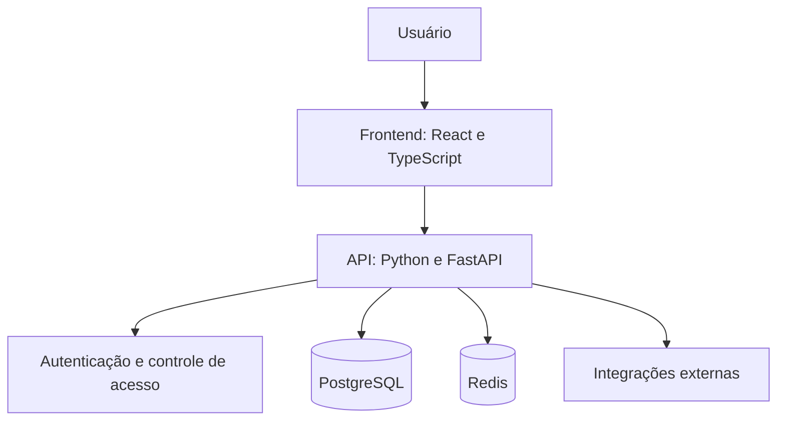

# Olá, eu sou o Aler Julion

### Desenvolvimento web | APIs | Automação | Robótica

Sou engenheiro de computação e desenvolvo projetos que conectam **interfaces**, **backend**, **dados** e **automação**.

---

## Sobre mim

Meus projetos incluem aplicações de finanças pessoais, integrações de mensagens, interfaces web e robótica com visão computacional.

No desenvolvimento web, utilizo **Python e FastAPI** no backend e **React e TypeScript** no frontend, com **Vite** ou **Next.js**. Trabalho com persistência de dados, autenticação, integração entre serviços e ambientes com **Docker**.

Na robótica, desenvolvi um protótipo com **Python, OpenCV, NumPy e marcadores ArUco**, envolvendo calibração de câmera, estimativa de posição e controle de movimento.

Tenho interesse em IA aplicada e venho estruturando estudos de planejamento de projetos com prompts, regras explícitas e validação de respostas.

---

## Tecnologias utilizadas nos meus projetos

### Desenvolvimento web

  
  
  
  
  
  
  

| Área | Ferramentas utilizadas |
|---|---|
| Backend e validação | FastAPI, Pydantic, Uvicorn |
| Frontend e navegação | React, TypeScript, Vite, Next.js, Tailwind CSS, React Router |
| Dados e formulários no frontend | TanStack Query, React Hook Form, Zod |
| Persistência e migrações | PostgreSQL, SQLAlchemy, Alembic |
| Cache e integrações | Redis, Supabase, APIs HTTP |

### Containers e automação

  
  
  

Utilizo Docker e Docker Compose para organizar serviços e dependências. Meus repositórios também incluem workflows com GitHub Actions para publicação de imagens no GitHub Container Registry (GHCR) e automação de releases.

### Testes e qualidade

  
  
  

Meus projetos incluem testes de backend e frontend, verificação de tipos e lint. Também trabalho com documentação em Markdown, contratos de API e organização modular do backend.

### Robótica e visão computacional

  
  

- Detecção de marcadores ArUco e estimativa de posição e orientação.
- Calibração de câmera.
- Controle de movimento com GPIO e integração entre percepção e controle.
- Evolução de um protótipo acadêmico de navegação para uma arquitetura modular.

---

## Segurança no desenvolvimento

Nos projetos web, trabalho com autenticação, controle de acesso, validação de entradas e proteção de sessões. O backend de finanças inclui hash de senhas com **Argon2**, sessões no servidor e limitação de requisições.

Meu foco é incorporar essas práticas ao desenvolvimento e verificar o comportamento com testes.

---

## Como organizo meus projetos web

---

## Estudos e interesses

- IA como apoio ao planejamento, com prompts estruturados e validação de respostas.
- Arquitetura modular e integração entre frontend, backend e dados.
- Segurança aplicada ao desenvolvimento de APIs.
- Automação de ambientes e processos de entrega.
- Robótica móvel e visão computacional.

---

## Contribuições

---

## Contato

---

### Construindo e aprendendo com projetos reais.

